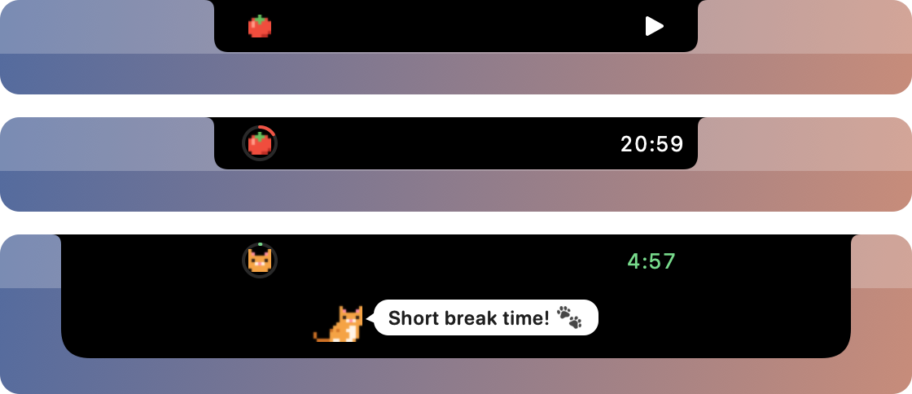

# Tomeow

A tiny Pomodoro timer that lives in the MacBook notch. Click the island to start a focus round. When it ends, a pixel-art cat runs out of the notch to tell you to take a short break.

<p align="center">
  
</p>

## Features

- Sits around the notch as a small black "island", with a tomato on one side and the countdown on the other. Screens without a notch get a small pill at the top centre instead.
- When a focus round ends, the island opens and a ginger pixel cat drops out of the notch with a "Short break time!" bubble. When the break ends, the cat runs back in.
- Round lengths are picked from presets: 25/5 (default), 50/10 or 15/3 minutes.
- Optional auto-start of the next round after a break, a chime (on by default), and launch at login.
- No Dock icon and no windows. Everything happens on the island.

## Usage

| Action | Result |
| --- | --- |
| Click the island | Start a round, or pause/resume the current one |
| Click while the cat is out | Send the cat away, or start the next round when it asks "Ready? ▶" |
| Right-click or Ctrl-click | Menu: start/pause/reset, skip break, durations, auto-start, sound, launch at login, quit |

The countdown dims while paused. During a break the icon turns into a cat face and the countdown turns green.

## Requirements

- macOS 14 or later. It's designed for MacBooks with a notch but works on any screen.
- To build: Swift 6 (the Xcode Command Line Tools are enough; full Xcode isn't needed).

## Build and install

```sh
./build.sh            # builds build/Tomeow.app
./build.sh install    # also copies it to ~/Applications
open build/Tomeow.app
```

To watch a whole cycle quickly, run it in demo mode, where every minute lasts one second:

```sh
open build/Tomeow.app --args --demo
```

## Resource use

Tomeow is built to stay out of the way. It uses AppKit and Core Animation only, with no SwiftUI. Measured on a 16-inch MacBook Pro (M1 Pro):

| | |
| --- | --- |
| Binary size | ~140 KB |
| Memory | ~11 MB |
| CPU while idle | 0%, no wakeups |
| CPU while counting down | ~0.03% |

Here is how it stays that light:

- The cat's animations run in the system's render server, not in the app.
- The countdown is built from pre-rendered digit images, so each second only swaps images instead of drawing text.
- The timer only wakes once a second while a round is running, and not at all when idle, paused or while the display sleeps.

## Project layout

```
Sources/Tomeow/
  main.swift            app entry point
  AppDelegate.swift     timer flow, right-click menu, sleep/wake and screen changes
  PomodoroTimer.swift   countdown state machine, presets and settings
  IslandWindow.swift    notch geometry and the borderless panel above the menu bar
  IslandView.swift      the island: outline, icons, progress ring, countdown
  CatShow.swift         the cat's entrance and exit animations
  PixelArt.swift        pixel-art sprites and the speech bubble
Resources/
  Info.plist
  AppIcon.icns          generated by Scripts/make-icon.swift
Scripts/
  make-icon.swift       draws the app icon
build.sh                builds, signs (ad hoc) and optionally installs the app
```

## App icon

The icon is pixel art drawn from a text grid in `Scripts/make-icon.swift`. After editing the grid, regenerate it with:

```sh
swift Scripts/make-icon.swift Resources/AppIcon.icns
```

Keep the background outline as it is: Apple's 824 px rounded square with 185.4 px corners, and no drop shadow. macOS 26 and later shows `.icns` icons that don't match that outline shrunk inside a grey frame.

## Notes

- The island covers menu bar items within about 60 pt of the notch. While the cat is out (about 7 seconds), it covers a larger area at the top of the screen.
- The app is signed ad hoc, so it is meant for your own Mac rather than distribution.

## License

[MIT](LICENSE)
